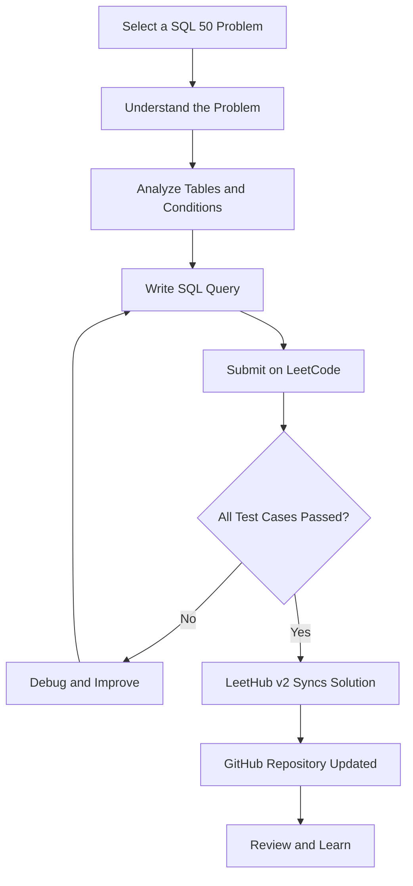

 <div align="center">

# 🗄️ SQL-50-LeetCode

### A Journey Through SQL Problem Solving

**My solutions to LeetCode's SQL 50 Study Plan — building strong SQL fundamentals, mastering database queries, and preparing for technical interviews.**

<p>
  <a href="https://leetcode.com/studyplan/top-sql-50/">
    
  </a>
  
  
  
</p>

<p>
  <a href="https://github.com/KishanJangid5">
    
  </a>
  <a href="https://leetcode.com/u/kishan-jangid/">
    
  </a>
</p>

</div>

---

## 📌 About This Repository

Welcome to my SQL problem-solving repository!

This repository documents my progress through the **LeetCode SQL 50 Study Plan**, a structured collection of SQL problems designed to strengthen database querying skills and prepare for SQL-based technical interviews.

Each accepted solution is automatically pushed to this repository using **LeetHub v2**, creating a record of my learning journey and problem-solving progress.

The primary objective is to develop a strong understanding of SQL concepts through consistent practice, logical thinking, and efficient query writing.

## 🎯 Learning Objectives

| Objective | Description |
|:---|:---|
| SQL Fundamentals | Strengthen SELECT, WHERE, ORDER BY, and filtering |
| Data Aggregation | Practice GROUP BY, HAVING, and aggregate functions |
| Database Relationships | Understand INNER JOIN, LEFT JOIN, and self joins |
| Advanced SQL | Explore subqueries, CTEs, and window functions |
| Query Optimization | Improve query readability and logical efficiency |
| Interview Preparation | Develop confidence in SQL technical interviews |

## 🧠 Topics Covered

The SQL 50 Study Plan provides a structured progression through essential SQL concepts.

<table>
  <tr>
    <td width="50%">
      <h3>🔹 Basic Queries</h3>
      <ul>
        <li>SELECT statements</li>
        <li>WHERE conditions</li>
        <li>ORDER BY</li>
        <li>LIMIT and filtering</li>
      </ul>
    </td>
    <td width="50%">
      <h3>🔹 Joins</h3>
      <ul>
        <li>INNER JOIN</li>
        <li>LEFT JOIN</li>
        <li>Self Joins</li>
        <li>Relational data queries</li>
      </ul>
    </td>
  </tr>
  <tr>
    <td width="50%">
      <h3>🔹 Aggregations</h3>
      <ul>
        <li>COUNT, SUM, AVG</li>
        <li>GROUP BY</li>
        <li>HAVING</li>
        <li>Conditional aggregation</li>
      </ul>
    </td>
    <td width="50%">
      <h3>🔹 Advanced SQL</h3>
      <ul>
        <li>Subqueries</li>
        <li>Common Table Expressions (CTEs)</li>
        <li>Window Functions</li>
        <li>Ranking and analytical queries</li>
      </ul>
    </td>
  </tr>
</table>

## ⚙️ Technology Stack

<p>
  
  
  
</p>

| Tool | Purpose |
|:---|:---|
| LeetCode | Solve SQL problems and validate solutions |
| SQL | Query language for relational databases |
| LeetHub v2 | Automatically synchronize accepted solutions |
| GitHub | Maintain version history and showcase progress |

## 🔄 Problem-Solving Workflow



## 📂 Repository Structure

LeetHub organizes accepted solutions into individual problem folders.

```text
SQL-50-LeetCode/
│
├── 1757-recyclable-and-low-fat-products/
│   └── solution.sql
│
├── <problem-folder>/
│   └── solution.sql
│
└── README.md
```

*The exact filenames and folder structure may vary depending on LeetHub's configuration.*

Each problem folder contains the SQL solution associated with its LeetCode problem.

## 📝 Solution Format

Solutions focus on readability, correctness, and understanding the underlying SQL concepts.

Example:

```sql
-- LeetCode 1757: Recyclable and Low Fat Products

SELECT product_id
FROM Products
WHERE low_fats = 'Y'
  AND recyclable = 'Y';
```

**Problem:** Find products that are both low-fat and recyclable.

**Concepts used:**
- SELECT
- WHERE
- AND operator
- Conditional filtering

This example demonstrates a basic filtering query. The repository will contain the accepted solutions for the problems I complete.

## 📈 Progress Tracker

My goal is to complete the entire SQL 50 Study Plan and earn the corresponding LeetCode badge.

| Milestone | Status |
|:---|:---|
| Start SQL 50 Study Plan | In Progress |
| Complete Basic SQL Problems | In Progress |
| Complete JOIN Problems | In Progress |
| Complete Advanced SQL Problems | In Progress |
| Solve All 50 Problems | Goal |
| Earn SQL 50 Badge | Goal |

> Progress is tracked through my LeetCode profile and the solutions committed to this repository.

## 🌱 Why This Repository?

This repository is more than a collection of SQL queries.

It represents my commitment to:

- Practicing SQL consistently.
- Strengthening my database fundamentals.
- Improving analytical and logical thinking.
- Preparing for Data Analyst, BI Analyst, and Data Engineer interviews.
- Building a public record of my technical learning journey.

## 👨‍💻 About Me

<div align="center">

### Kishan Jangid

**Aspiring Data Engineer | SQL & Python | Data Analytics**

MCA Student at MIT-WPU, Pune

I am passionate about SQL, data analytics, database management, and backend development. I am continuously improving my technical skills through hands-on projects, problem-solving, and structured learning.

<p>
  <a href="https://github.com/KishanJangid5">
    
  </a>
  <a href="https://leetcode.com/u/kishan-jangid/">
    
  </a>
  <a href="https://www.linkedin.com/in/kishanjangid/">
    
  </a>
</p>

</div>

---

<div align="center">

### 🚀 Learn. Practice. Improve. Repeat.

*Every query is a step toward becoming a better problem solver.*

**Thank you for visiting my repository!**

</div>
